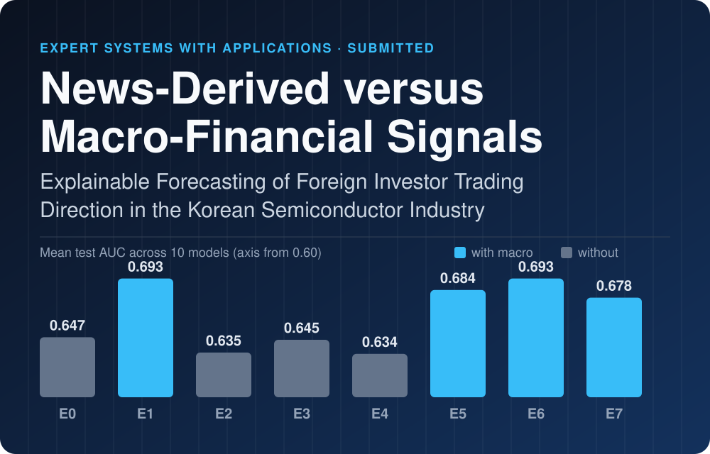
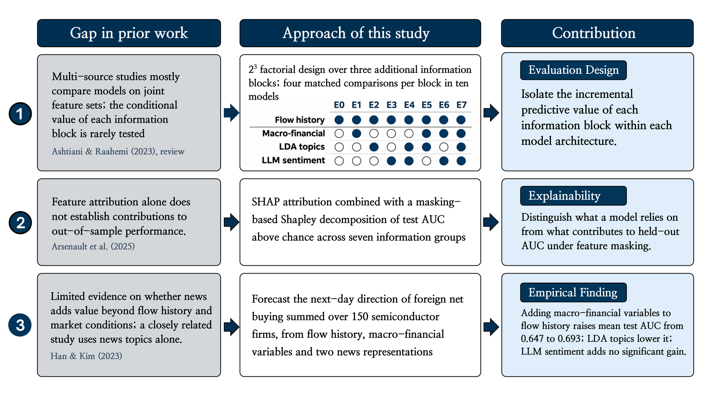
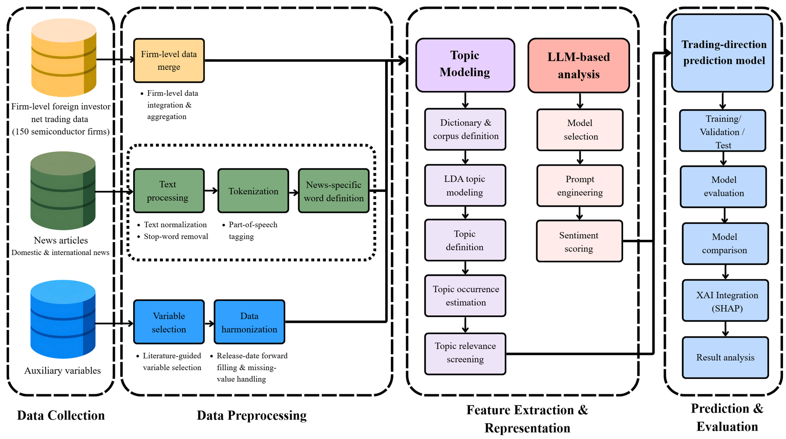
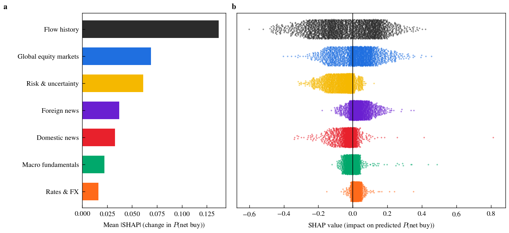
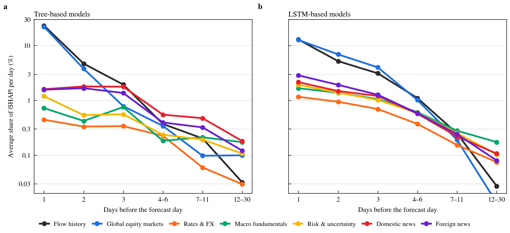
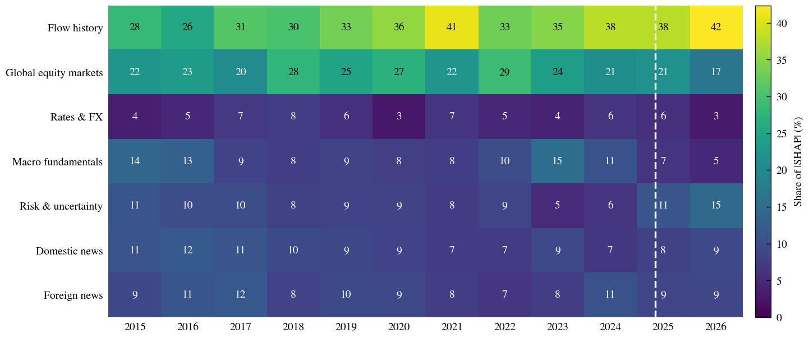
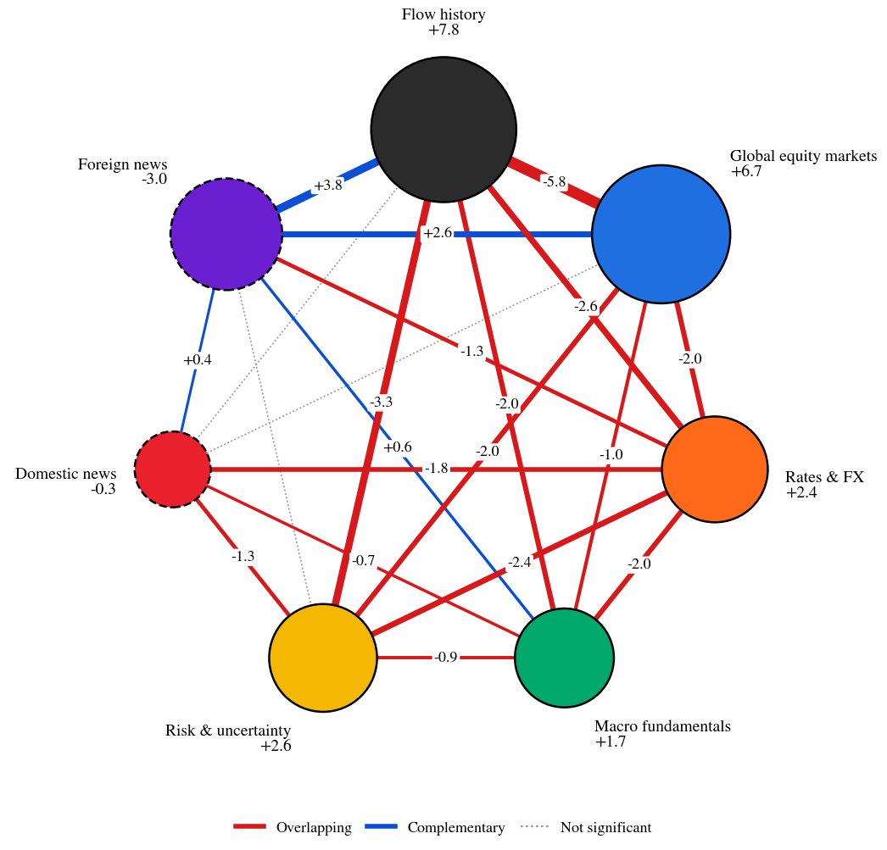
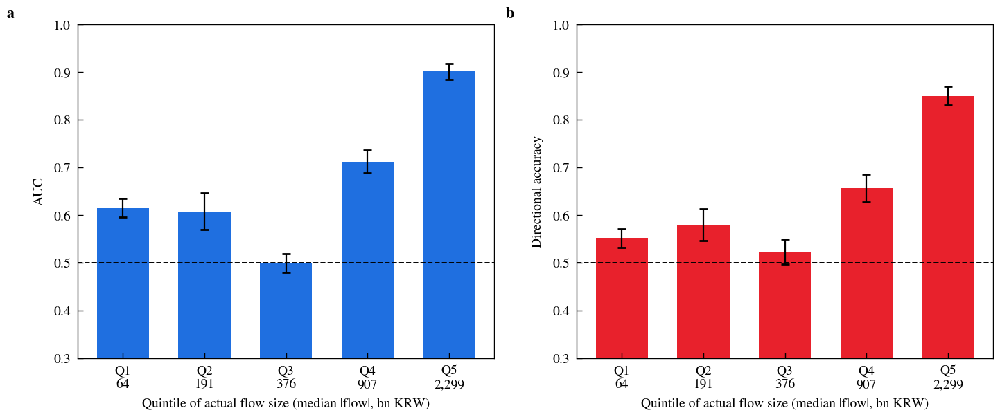
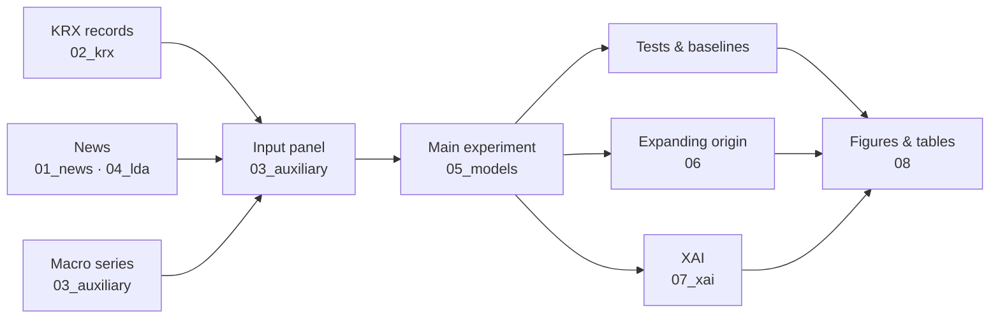
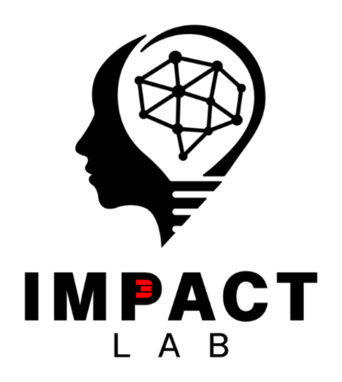

<div align="center">



<h1>News-Derived versus Macro-Financial Signals: Explainable Forecasting of Foreign Investor Trading Direction in the Korean Semiconductor Industry</h1>

**John Park<sup>1</sup> · Maximiliano Islas Solis<sup>1</sup> · Seohyun Lee<sup>2</sup> · Duk-Jo Kong<sup>1</sup>**

<sup>1</sup> Graduate School of AI Policy and Strategy, GIST &nbsp;&nbsp; <sup>2</sup> KDI School of Public Policy and Management

<br>

[](#citation)
[](LICENSE)
[](https://www.python.org/)
[](https://pytorch.org/)
[](https://github.com/shap/shap)
[](#models)
[](#robustness)

<b>
<a href="#abstract">Abstract</a> &nbsp;·&nbsp;
<a href="#key-findings">Findings</a> &nbsp;·&nbsp;
<a href="#experimental-design">Design</a> &nbsp;·&nbsp;
<a href="#data-availability">Data</a> &nbsp;·&nbsp;
<a href="#reproducing-the-results">Reproduce</a> &nbsp;·&nbsp;
<a href="#citation">Citation</a> &nbsp;·&nbsp;
<a href="#한국어-요약">한국어 요약</a>
</b>

<br><br>

<table>
  <tr>
    <td align="center" width="50%">
      <br>
      <h3>John Park <sub>박준</sub></h3>
      M.S. student · <a href="https://impact.gist.ac.kr/team/students.php">GIST IMPACT Lab</a><br>
      <sub>Semiconductor &amp; financial data forecasting · AI strategy &amp; data analytics</sub><br><br>
      <a href="https://github.com/parkjohn10277"></a>
    </td>
    <td align="center" width="50%">
      <br>
      <h3>Maximiliano Islas Solis <sub>MAX</sub></h3>
      M.S. student · <a href="https://impact.gist.ac.kr/team/students.php">GIST IMPACT Lab</a><br>
      <sub>Data analysis · ML econometrics</sub><br><br>
      <a href="https://github.com/MaximilianoIS"></a>
    </td>
  </tr>
</table>

<sub>John Park and Maximiliano Islas Solis contributed equally.</sub>

</div>

---

> [!IMPORTANT]
> **In one line.** Next-day foreign buying or selling of Korean chip stocks is forecast best by recent flows plus global market and macro-financial signals. Adding news — as LDA topics or LLM sentiment — does not help.

This repository holds the code, public data and aggregate results of the paper. It compares three information blocks added to the history of foreign net buying — **macro-financial variables**, **LDA news topics** and **LLM news sentiment** — in a 2³ factorial design across ten forecasting models, and explains the forecasts with SHAP.

<table>
  <tr>
    <td align="center" width="20%"><h2>150</h2>semiconductor firms<br><sub>KOSPI + KOSDAQ</sub></td>
    <td align="center" width="20%"><h2>2,780</h2>forecast days<br><sub>Mar 2015 – Jun 2026</sub></td>
    <td align="center" width="20%"><h2>8 × 10</h2>feature sets × models<br><sub>5 seeds each</sub></td>
    <td align="center" width="20%"><h2>+4.69</h2>AUC points (×100)<br><sub>from the macro-financial block</sub></td>
    <td align="center" width="20%"><h2>0.718</h2>best test AUC<br><sub>LightGBM, E1</sub></td>
  </tr>
</table>

## Abstract

Foreign investors are a fundamental driver of the Korean stock market, yet forecasting research has targeted prices and indices rather than their behavior. This study forecasts the next-day net-buy versus net-sell direction of foreign investors in the Korean semiconductor industry within an explainable multi-source framework. Daily net flows of 150 listed firms (2015–2026) are combined with 1.15 million domestic and international news articles, represented by latent Dirichlet allocation (LDA) topics and large language model (LLM)-derived sentiment, and with 13 release-aligned macro-financial variables. Eight feature configurations (E0–E7), forming a 2³ factorial design over the three information blocks, are evaluated across ten forecasting models with within-model and across-model significance tests. Macro-financial variables provide the only consistent gain, raising the mean out-of-sample area under the receiver operating characteristic curve (AUC) from 0.647 to 0.693 and improving nine of ten models; LLM sentiment adds no significant value and LDA topics reduce the AUC. SHapley Additive exPlanations (SHAP) trace most predictive information to recent flow history and global equity returns, with accuracy highest on large-flow days and an asymmetric response to falls in global semiconductor stocks. Foreign-investor trading in a globally integrated industry is thus most informatively tracked by combining recent trading history with global market signals, and each additional information source should be validated for its incremental value before it is adopted.

<p align="center">
  
  <br><sub><b>Fig. 1.</b> Gaps in prior work, the approach of this study and its contributions.</sub>
</p>

<p align="center">
  
  <br><sub><b>Research framework.</b> Data collection → preprocessing → topic and LLM features → forecasting and SHAP.</sub>
</p>

## Key findings

| Finding | Evidence |
|---|---|
| **Macro-financial variables carry the signal** | Adding them raises the mean test AUC from **0.647 to 0.693**, and 9 of 10 models improve (Wilcoxon *p* = 0.004). |
| **News does not add to them** | LDA topics lower the AUC (−1.16 points, 1 of 10 models improve). LLM sentiment has no significant effect (−0.22 points, *p* = 0.49). |
| **Best model** | LightGBM on KRX + macro (E1), **AUC 0.718**. |
| **Simple baselines matter** | Without the macro block, no model beats a persistence forecast. No model beats a logistic regression on the same inputs. |
| **The result holds over time** | In an expanding-origin evaluation (test years 2022, 2023 and 2024), the macro block raises the AUC in every year. |

<table>
  <tr>
    <td width="52%"></td>
    <td width="48%"></td>
  </tr>
  <tr>
    <td align="center"><sub><b>Test AUC by feature set</b> (E0–E7, ten models)</sub></td>
    <td align="center"><sub><b>Change in AUC from adding each block</b>, per model, with DeLong significance</sub></td>
  </tr>
</table>

### What the models rely on

<table>
  <tr>
    <td width="50%"></td>
    <td width="50%"></td>
  </tr>
  <tr>
    <td align="center"><sub><b>SHAP by information group.</b> Flow history and global equity markets dominate.</sub></td>
    <td align="center"><sub><b>SHAP by lag.</b> Most attribution falls on the last one to three days.</sub></td>
  </tr>
</table>

<details>
<summary><b>More XAI figures</b> (temporal shares, group interactions, flow-size quintiles)</summary>
<br>
<p align="center"><br><sub>Share of |SHAP| by information group and year.</sub></p>
<p align="center"><br><sub>AUC-based Shapley interactions between information groups: overlapping (red) or complementary (blue).</sub></p>
<p align="center"><br><sub>AUC and directional accuracy by quintile of realised flow size.</sub></p>
</details>

## Experimental design

The design is a 2³ factorial over three information blocks, each added to the history of foreign net buying (KRX):

| Set | KRX | LDA | LLM | AUX | Features | Mean AUC (10 models) |
|---|:-:|:-:|:-:|:-:|:-:|:-:|
| E0 | ✓ | | | | 1 | 0.647 |
| E1 | ✓ | | | ✓ | 14 | **0.693** |
| E2 | ✓ | ✓ | | | 12 | 0.635 |
| E3 | ✓ | | ✓ | | 5 | 0.645 |
| E4 | ✓ | ✓ | ✓ | | 16 | 0.634 |
| E5 | ✓ | ✓ | | ✓ | 25 | 0.684 |
| E6 | ✓ | | ✓ | ✓ | 18 | **0.693** |
| E7 | ✓ | ✓ | ✓ | ✓ | 29 | 0.678 |

- **KRX:** daily foreign net-buy value summed over the semiconductor firms.
- **LDA:** daily topic shares from Korean and English news.
- **LLM:** daily sentiment from EXAONE 3.5 7.8B for four sources: MCST NOW, NAVER News, GDELT and NYT.
- **AUX:** 13 release-dated macro-financial variables, listed below.

<details>
<summary><b>The 13 macro-financial (AUX) variables</b></summary>
<br>

The 13 variables of the AUX block, as listed in the paper. The last column shows whether the original series is in [`data/macro_public/`](data/macro_public).

| No. | Group | Variable | Freq. | In this repo |
|:-:|---|---|:-:|:-:|
| 1 | Global equity markets | S&P 500 return (log) | D | ✗ licence |
| 2 | Global equity markets | Global stock market return (log) | D | ✗ licence |
| 3 | Global equity markets | Philadelphia Semiconductor Index return (log) | D | ✗ licence |
| 4 | Rates & FX | KRW/USD exchange rate | D | ✓ |
| 5 | Rates & FX | 3-year KTB yield minus policy rate | D | ✓ |
| 6 | Macro fundamentals | CPI inflation (y/y) | M | ✓ |
| 7 | Macro fundamentals | Nominal GDP growth (y/y) | Q | ✓ |
| 8 | Macro fundamentals | Unemployment rate | M | ✓ |
| 9 | Macro fundamentals | Semiconductor production growth (y/y) | M | ✓ |
| 10 | Risk & uncertainty | VKOSPI (implied volatility) | D | ✗ licence |
| 11 | Risk & uncertainty | Global economic policy uncertainty | M | ✓ |
| 12 | Risk & uncertainty | Geopolitical risk, global | M | ✓ |
| 13 | Risk & uncertainty | Geopolitical risk, Korea | M | ✓ |

D = daily, M = monthly, Q = quarterly.

</details>

### Models

| Family | Models |
|---|---|
| Recurrent | LSTM, BiLSTM, GRU-LSTM, BiGRU-LSTM, CNN-LSTM |
| Attention | DA-RNN, iTransformer |
| Tree ensembles | Random Forest, XGBoost, LightGBM |
| Baselines | majority class, persistence, logistic regression |

Every model is run with five seeds (42–46): 10 models × 8 feature sets × 5 seeds = 400 runs. The runs are compared with DeLong tests, block bootstrap, Diebold–Mariano tests, Wilcoxon tests across models, and the Model Confidence Set.

### Robustness

- **Release-dated macro inputs.** Each variable enters only after its publication lag (table below).
- **Expanding-origin evaluation** with test years 2022, 2023 and 2024, for all ten models plus the logit (1,480 additional runs).
- **Block bootstrap.** Circular block bootstrap of the test days (10-day blocks, 5,000 resamples) alongside the DeLong tests.
- **Explanations.** SHAP and attention analysis by information group, lag and period.

<details>
<summary><b>Publication lags</b></summary>
<br>

| Variable | Lag (days) |
|---|---|
| CPI | 5 |
| Unemployment | 16 |
| Semiconductor production | 31 |
| Nominal GDP | 70 |
| EPU / GPR | 7 |

</details>

## Data availability

> [!NOTE]
> Not all of the data can be redistributed. This repository contains only what can be shared, and explains how to obtain the rest. Daily predictions, model checkpoints and the model input panel are not included, because they contain the KRX flow series.

| Data | Included | How to obtain |
|---|:-:|---|
| Firm-level investor-type trading records (KRX) | ✗ | KRX's terms prohibit redistribution. Download free from the [KRX Data Marketplace](https://data.krx.co.kr) using [`data/KRX_DOWNLOAD_GUIDE.md`](data/KRX_DOWNLOAD_GUIDE.md) and [`data/krx_firm_list.csv`](data/krx_firm_list.csv) |
| MCST NOW Platform news | ✗ | Provided for this research by the Ministry of Culture, Sports and Tourism ([now.go.kr](https://www.now.go.kr)) |
| NAVER News, GDELT, NYT articles | ✗ | The providers' public APIs, using [`code/01_news/`](code/01_news) |
| VKOSPI, S&P 500, PHLX SOX, global indices | ✗ | Index licences. Available from KRX, S&P Dow Jones Indices, Nasdaq or a market-data vendor |
| CPI, GDP, semiconductor production, unemployment | ✓ | [KOSIS](https://kosis.kr) |
| KRW/USD exchange rate, interest-rate spread | ✓ | [Bank of Korea ECOS](https://ecos.bok.or.kr) |
| Economic Policy Uncertainty | ✓ | [policyuncertainty.com](https://www.policyuncertainty.com) |
| Geopolitical Risk index | ✓ | [matteoiacoviello.com/gpr.htm](https://www.matteoiacoviello.com/gpr.htm) |
| Metrics, tests, XAI summaries, figures | ✓ | [`results/`](results), [`figures/`](figures) |

## Reproducing the results



1. **Build the KRX target.** Follow [`data/KRX_DOWNLOAD_GUIDE.md`](data/KRX_DOWNLOAD_GUIDE.md), then run `python code/02_krx/combine_krx_150.py`.
2. **Build the text features.** Run the LDA pipeline (`code/04_lda/scripts/run_all.py`) and the LLM sentiment scripts (`code/01_news/sentiment_llm/`).
3. **Build the macro panel and the input file.** Run `code/03_auxiliary/build_daily_panel.py` and then `build_input_gdp_corrected.py`. The result is `data/input_gdp_corrected.csv`; see [`data/input_schema.md`](data/input_schema.md).
4. **Main experiment.** Run `code/05_models/run_final.py`, then `Tests/run_tests.py` and `Baselines/run_baselines.py`.
5. **Robustness, XAI and figures.** Use `code/06_expanding_origin/`, `code/07_xai/` and `code/08_figures_tables/build_all.py`.

> [!TIP]
> Each model folder has its own `requirements.txt`. The main dependencies are PyTorch, scikit-learn, XGBoost, LightGBM, SHAP, gensim, kiwipiepy and pandas. Scripts use paths relative to the repository root; some have path constants at the top that you may need to adjust.

## Repository structure

```
├── code/
│   ├── 01_news/               news collection, preprocessing, LLM sentiment (prompt: PROMPT.txt)
│   ├── 02_krx/                aggregation of the firm-level KRX investor-type records
│   ├── 03_auxiliary/          daily macro panel and the publication-lag correction
│   ├── 04_lda/                Korean and English LDA pipeline (scripts 00–06)
│   ├── 05_models/             main experiment, statistical tests, baselines
│   ├── 06_expanding_origin/   robustness windows W1–W3
│   ├── 07_xai/                SHAP and attention analysis
│   └── 08_figures_tables/     scripts for every figure and table in the paper
├── data/
│   ├── macro_public/          original public macro series (KOSIS, Bank of Korea, EPU, GPR)
│   ├── krx_firm_list.csv      the 150 firms (stock code, Korean and English name; Supplementary Table S1)
│   ├── KRX_DOWNLOAD_GUIDE.md  how to download and rebuild the KRX flow series
│   └── input_schema.md        column layout of the model input panel
├── results/                   all metrics and tests behind the tables (CSV / TXT / LaTeX)
└── figures/                   figures as they appear in the paper
```

## Citation

If you use this code, please cite the paper (full reference to be added on publication). See also [`CITATION.cff`](CITATION.cff).

```bibtex
@article{park_foreign_flow,
  title   = {News-Derived versus Macro-Financial Signals: Explainable Forecasting of
             Foreign Investor Trading Direction in the Korean Semiconductor Industry},
  author  = {Park, John and Islas Solis, Maximiliano and Lee, Seohyun and Kong, Duk-Jo},
  journal = {Expert Systems with Applications},
  note    = {Under review}
}
```

## Acknowledgements

<table align="center">
  <tr>
    <td align="center" width="220"><a href="https://impact.gist.ac.kr/main/main.php"></a></td>
    <td align="center" width="220"><a href="https://impact.gist.ac.kr/team/professor.php"></a><br><b>Prof. Duk-Jo Kong</b> (공득조)<br><sub>Vice Dean, Assistant Professor<br>GIST AI Policy &amp; Strategy Graduate School</sub></td>
  </tr>
</table>

This work was carried out at the [**IMPACT Lab**](https://impact.gist.ac.kr/main/main.php) led by Prof. Duk-Jo Kong at the Gwangju Institute of Science and Technology (GIST). We thank the members of the lab for their discussions and support throughout the project.

We are especially grateful to [**Prof. Seohyun Lee**](https://www.kdischool.ac.kr/faculty/view.es?mid=a10401010000&type=1&page=2&emp_no=311000339) of the KDI School of Public Policy and Management for her guidance on the macro-financial side of this work, including economic uncertainty and geopolitical risk.

We also thank the Ministry of Culture, Sports and Tourism of the Republic of Korea for providing the MCST NOW Platform news data.

## 한국어 요약

**뉴스 신호 vs 거시·금융 신호: 한국 반도체 산업 외국인 투자자 매매 방향의 설명가능 예측** (Expert Systems with Applications 투고)<br/>
박준 · Maximiliano Islas Solis · 이서현 · 공득조 (GIST AI정책전략대학원 IMPACT Lab)

외국인 투자자가 **다음 거래일에 한국 반도체 주식을 순매수할지 순매도할지** 예측하고, 어떤 정보가 예측에 실제로 도움이 되는지 비교한 연구의 코드·공개 데이터·결과입니다.

- **비교한 정보:** 거시·금융 변수 13개(환율, 금리 스프레드, CPI, GDP, 실업률, 반도체 생산, 경제정책 불확실성, 지정학적 위험 등), 뉴스 LDA 토픽, LLM(EXAONE 3.5) 뉴스 감성
- **실험:** 딥러닝·트리 모델 10개(LSTM, BiLSTM, GRU-LSTM, BiGRU-LSTM, CNN-LSTM, DA-RNN, iTransformer, 랜덤 포레스트, XGBoost, LightGBM) × 특성 조합 8개 × 시드 5개 = 400회, 강건성 실험 1,480회
- **결과:** 거시·금융 변수를 넣으면 평균 테스트 AUC가 0.647에서 0.693으로 오르고 10개 모델 중 9개가 개선됩니다. 뉴스 토픽과 LLM 감성은 추가 효과가 없었습니다. 최고 성능은 LightGBM(AUC 0.718)입니다.
- **설명가능 AI:** SHAP과 어텐션 분석으로 어떤 정보·시차·시기가 예측을 이끄는지 확인했습니다.

**키워드:** 주가 예측, 주식 예측, 외국인 순매수 예측, 외국인 수급, 주가 방향 예측, 반도체 주가, 삼성전자, SK하이닉스, 반도체 주식, 코스피, 금융 시계열 예측, 뉴스 감성분석, 토픽 모델링, 거시경제 변수, 설명가능 인공지능(XAI), 딥러닝, 머신러닝

## Keywords

**Keywords:** stock prediction, stock market prediction, stock price prediction, stock direction prediction, foreign investor flows, Korean stock market (KOSPI, KOSDAQ), semiconductor stocks, Samsung Electronics, SK hynix, financial time series forecasting, deep learning, machine learning, explainable AI (XAI), SHAP, news sentiment analysis, LLM, LDA topic modeling, macroeconomic indicators, LSTM, iTransformer, LightGBM, XGBoost

**🇰🇷 검색어:** 주가 예측, 주식 예측, 주가 방향 예측, 주식 시장 예측, 외국인 순매수 예측, 외국인 수급, 외국인 투자자, 반도체 주식, 반도체 주가, 삼성전자, SK하이닉스, 코스피, 코스닥, 한국 주식시장, 금융 시계열 예측, 딥러닝 주가 예측, 머신러닝, 인공지능 투자, 뉴스 감성분석, LLM 감성분석, 토픽 모델링, 거시경제 변수, 설명가능 인공지능(XAI), SHAP

## Licence

The code is released under the [MIT Licence](LICENSE). The files in `data/macro_public/` remain under the terms of their original publishers.
